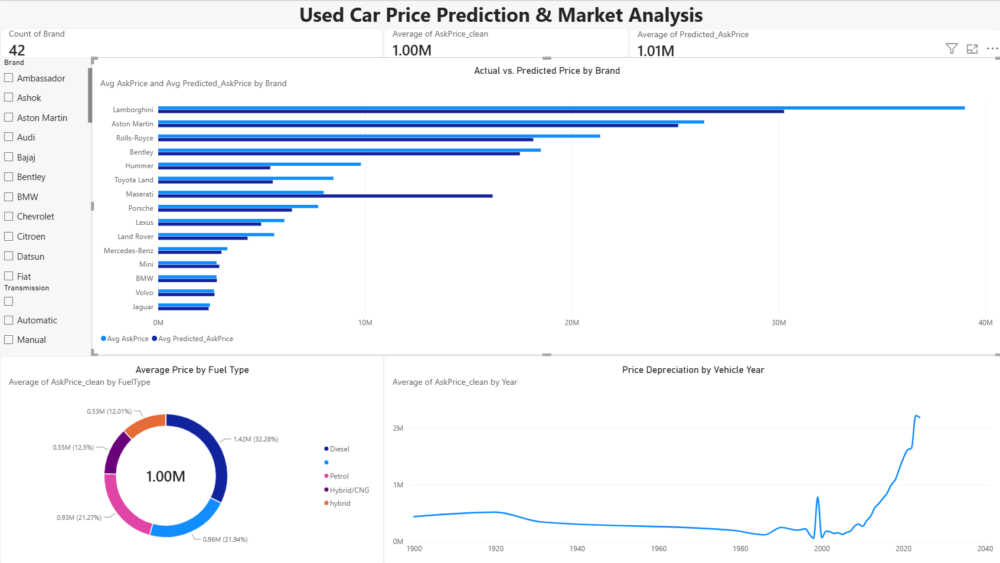

# 🚗 Used Car Price Prediction & Market Analysis

## 📌 Project Overview
This project delivers an end-to-end Machine Learning and Business Intelligence solution to predict used car asking prices and analyze market dynamics. It integrates data preprocessing, predictive modeling, and an interactive Power BI dashboard.

---

## 📊 Dashboard Preview & Key Insights



### Core Findings
* 🏎️ **Model Alignment:** Predicted values closely track actual asking prices across luxury segments (e.g., Lamborghini, Aston Martin), demonstrating strong predictive accuracy on high-value inventory.
* ⛽ **Fuel Type Valuation:** Diesel vehicles command the highest average price point, accounting for **32.3%** of total platform valuation share.
* 📉 **Depreciation Trends:** Valuations stay steady for older manufacturing years, with exponential price progression occurring on models built after **2015**.

---

## 🛠️ Tech Stack & Structure
* 🐍 **Python:** Data cleaning and model training (`scripts/clean_and_train.py`)
* 📊 **Power BI:** Interactive dashboard (`dashboard/Used_Car_Price_Analysis.pbix`)
* 📁 **Data:** Raw and engineered datasets stored in `data/`

```text
Car_Price_Project/
├── dashboard/
│   ├── Used_Car_Price_Analysis.pbix   # Interactive Power BI Report
│   ├── Used_Car_Price_Analysis.pdf    # Static PDF Export
│   └── Used_Car_Price_Analysis.png    # Dashboard Image
├── data/
│   ├── Used_Car_Dataset.csv           # Raw Dataset
│   └── processed_car_data.csv         # Cleaned Dataset with Predictions
├── scripts/
│   └── clean_and_train.py             # Python Cleaning & ML Pipeline
└── README.md                          # Project Documentation
```

---

## 🤖 Machine Learning Model & Pipeline

### 🛠️ Pipeline Details
* 🧼 **Data Cleaning:** Removed currency symbols (`₹`), distance units (`km`), and commas from target and feature columns (`AskPrice_clean`, `kmDriven_clean`).
* 🩹 **Imputation:** Handled missing values using median strategy for numerical features (`Engine_Capacity_CC`) and mode for discrete categories (`Seating_Capacity`).
* ⚙️ **Categorical Encoding:** Applied One-Hot Encoding to categorical variables (`Transmission`, `FuelType`, `Owner`).
* 🌲 **Algorithm Selection:** Trained a **Random Forest Regressor** (`n_estimators=100`, `random_state=42`) using an 80/20 train-test split.

### 📈 Performance Metrics
* 🎯 **$R²$ Score:** `0.62` — The Random Forest model explains 62% of the variance in used car asking prices.
* 📉 **Mean Absolute Error (MAE):** `₹320,210.66` — On average, model predictions deviate from actual asking prices by approximately ₹3.20 Lakhs.

---

## 🚀 How to Run

1.## **Clone the Repository:**
   ```bash
   git clone [https://github.com/your-username/Car_Price_Project.git](https://github.com/your-username/Car_Price_Project.git)
   cd Car_Price_Project
   ```

2. **Run Data & Training Pipeline:**
   ```bash
   python scripts/clean_and_train.py
   ```

3. **Explore Dashboard:**
   * Open `dashboard/Used_Car_Price_Analysis.pbix` in **Power BI Desktop**.